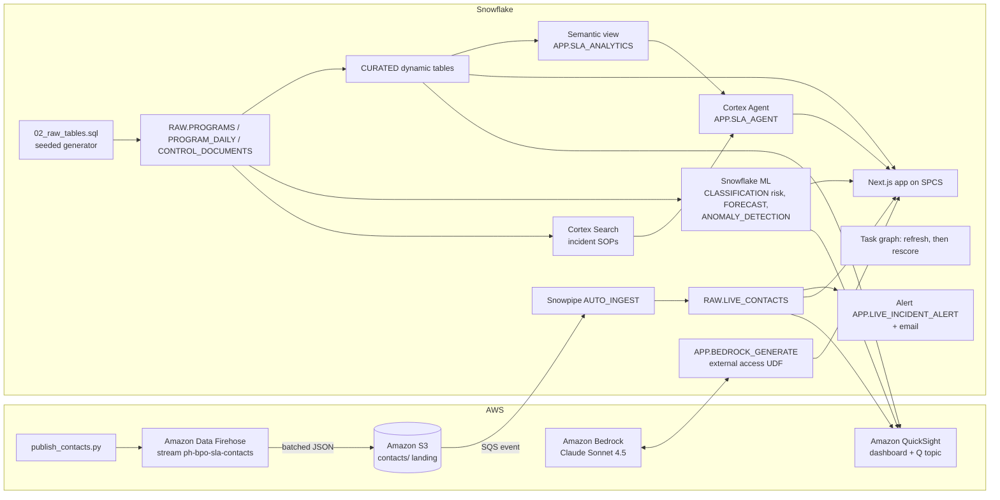

# Philippines BPO Client SLA Monitor - SLA Breaches and Incident Risk

End-to-end client SLA monitoring for **40 client programs of a fictional Philippine BPO served from 5 cities** (Taguig City, Pasig City, Cebu City, Davao City, Bacolod City) using Snowflake, optionally with AWS: from a live contact-centre incident to a 7-day SLA-breach risk score, an alert email and an AI action memo for the client service delivery team.

## Architecture

A client-SLA pipeline built on **Snowflake** (Dynamic Tables, Snowflake ML, Cortex Search, Cortex Agent, Cortex AI_COMPLETE, SPCS) and, in the full build, **AWS** (Amazon Data Firehose, S3, Bedrock Claude, QuickSight + Amazon Q). Contact events land in `RAW.LIVE_CONTACTS`. Dynamic tables curate 90 days of program-day history: contacts handled, billable value, incidents raised (volume spikes, staffing shortfalls, telephony outages and more), incidents that made the program miss its daily service-level target, client penalty notices, and QA calibration and client document compliance. Snowflake ML scores 7-day SLA-breach risk per program, forecasts incident volume across all programs and flags abandon-rate anomalies. A Cortex Agent answers questions with SOP citations, and an LLM drafts the service delivery action memo.

Interactive diagrams (hover for object names): [Snowflake only](docs/architecture-snowflake.html) | [AWS + Snowflake](docs/architecture-aws.html). The app shows both on its Architecture & Data tab, the current build first. Regenerate them with `python3 docs/build_architecture.py`.



The Snowflake-only build drops the AWS subgraph: `APP.SIMULATE_CONTACTS` writes to `RAW.LIVE_CONTACTS`, and the app calls Cortex `AI_COMPLETE` instead of the Bedrock UDF.

## Snowflake Capabilities

| Capability | Implementation |
|-----------|---------------|
| Dynamic Tables | `CURATED.KPI_SUMMARY`, `PERFORMANCE_SUMMARY`, `INCIDENT_SUMMARY`, `TREND_ANALYSIS` from the RAW tables |
| Snowflake ML | CLASSIFICATION 7-day SLA-breach risk (`ML.BREACH_RISK_SCORES`), 14-day incident-volume FORECAST, abandon-rate ANOMALY_DETECTION |
| Cortex Search | 14 synthetic incident-handling SOPs (one per channel and incident type) in `SEARCH.INCIDENT_SOP_SEARCH` |
| Semantic View | `APP.SLA_ANALYTICS` over programs, incident types, daily totals and risk |
| Cortex Agent | `APP.SLA_AGENT`: Cortex Analyst over the semantic view plus Cortex Search for SOP citations |
| Cortex AI | `AI_COMPLETE('claude-sonnet-4-5')` for grounded answers, and for the action memo in the Snowflake-only build |
| Alerts + Tasks | `APP.LIVE_INCIDENT_ALERT` logs INCIDENT events and sends email; task graph `TASK_REFRESH_CURATED`, then `TASK_RESCORE_RISK` |
| Snowpark Container Services | Next.js app `APP.PH_BPO_SLA_APP` with 6 tabs: Executive Cockpit, Predictive, Quality & Contracts, Live Contacts, Ask AI, Architecture & Data |
| Snowpipe | `RAW.LIVE_CONTACTS_PIPE` AUTO_INGEST from S3 (AWS build only) |

## AWS Services

Used only in the AWS + Snowflake build.

| Service | Role in Demo |
|---------|-------------|
| Amazon Data Firehose | Direct PUT stream `ph-bpo-sla-contacts` receives simulated contact events and writes batches to S3 |
| Amazon S3 | Landing bucket (`contacts/`). An event notification goes to the Snowpipe SQS queue |
| Amazon Bedrock | Claude Sonnet 4.5 writes the action memo, called from Snowflake through an external-access UDF |
| Amazon QuickSight | DIRECT_QUERY executive dashboard over Snowflake (daily incidents, SLA breaches by program, SLA-breach risk) |
| Amazon Q | Natural-language questions over the QuickSight topic `ph-bpo-sla-topic` |
| AWS IAM | Least-privilege roles for S3, Firehose and Bedrock |

## Personas

These personas are fictional.

| Persona | Role | Key Questions |
|---------|------|---------------|
| **Teresita Bautista** | Head of Client Service Delivery | "Which incident types cost us the daily service level?" "Which programs are heading for a client penalty notice?" |
| **Paolo Marquez** | Workforce and SLA Analyst | "Which programs are high risk this week, and which SOP applies?" "Where is the abandon rate drifting?" |

## Data

All data is synthetic and seeded, so every rebuild reproduces it. The BPO, its clients, programs and names are fictional.

| Table | Rows | Description |
|-------|------|-------------|
| RAW.PROGRAMS | 40 | Client programs served from 5 Philippine cities across 5 channels (Voice inbound, Chat support, Technical support, Back-office processing, Email support), with client risk tier and program age |
| RAW.PROGRAM_DAILY | 3,600 | Daily program observations over 90 days: contacts handled, billable value (PHP), incidents, SLA-breach incidents, client penalty notices, incident type, QA calibration audits, abandon rate and average handle time |
| RAW.CONTROL_DOCUMENTS | 40 | Required, on-file and pending client documents per program (SLA schedule, workforce plan, escalation matrix, data privacy checklist, continuity drill record) |
| SEARCH.INCIDENT_DOCS | 14 | Synthetic incident-handling SOPs indexed for Cortex Search |
| RAW.LIVE_CONTACTS | Grows during the demo | Live contact events from Firehose (AWS build) or `APP.SIMULATE_CONTACTS` (Snowflake-only build) |
| ML.BREACH_RISK_SCORES | 40 | 7-day SLA-breach probability and risk band per program |

## Build Instructions

### Prerequisites
- Snowflake account with ACCOUNTADMIN access, and Cortex AI enabled (AI_COMPLETE, Search, Agent).
- An X-Small warehouse with auto-suspend at or below 120 s, and an existing SPCS compute pool.
- Python 3.11+, `snowflake-connector-python`, Node.js 22+, Docker and the `snow` CLI.
- App image: run `snow spcs image-registry login`, then build and push `ph-bpo-sla-app:v1` to the database's `APP.IMAGES` repository (see the header of `snowflake/07_deploy_app.sql`).
- AWS build only: `boto3`, AWS credentials for the target account (us-west-2) with Bedrock access, and QuickSight Enterprise.

### SPCS App
```
<DATABASE>.APP.PH_BPO_SLA_APP
```

### Tests
```bash
python -m pytest aws snowflake quicksight
```

For a local run, put `SNOWFLAKE_ACCOUNT`, `SNOWFLAKE_USER`, `SNOWFLAKE_DATABASE`, `SNOWFLAKE_WAREHOUSE`, `SNOWFLAKE_AUTHENTICATOR=PROGRAMMATIC_ACCESS_TOKEN`, `SNOWFLAKE_TOKEN` and `DEMO_PLATFORM` in the environment, then run `npm --prefix app run build && npm --prefix app start`.

## Build Modes

Both modes share the same core. They differ in three places, and the app's `DEMO_PLATFORM` setting (in its SPCS spec) switches the memo provider and the Live Contacts tab.

| Layer | Snowflake Only | Full AWS + Snowflake |
|---|---|---|
| Live contacts | `CALL APP.SIMULATE_CONTACTS(n)` inserts simulated contact events into `RAW.LIVE_CONTACTS`. This simulates a contact-centre feed; it is not Snowpipe Streaming | `aws/publish_contacts.py` to Amazon Data Firehose, then S3, SQS and Snowpipe AUTO_INGEST |
| Action memo | Cortex `AI_COMPLETE('claude-sonnet-4-5')` | Amazon Bedrock Claude Sonnet 4.5 through `APP.BEDROCK_GENERATE` |
| BI and natural-language questions | The SPCS app is the dashboard; questions go to the Cortex Agent | Also a QuickSight dashboard and an Amazon Q topic |
| App setting | `DEMO_PLATFORM: snowflake` | `DEMO_PLATFORM: aws` |

### Snowflake Only

```bash
# 1. Core data and dynamic tables (guarded: new isolated database only)
python snowflake/run_core.py --database PHILIPPINES_BPO_SLA_SNOWFLAKE --warehouse <XS_WAREHOUSE> --connection <CONNECTION> --apply
# 2. Native contact feed, ML, search, semantic view, agent, alert and task graph
python snowflake/run_intelligence.py --database PHILIPPINES_BPO_SLA_SNOWFLAKE --platform snowflake --warehouse <XS_WAREHOUSE> --connection <CONNECTION> --alert-email you@example.com
# 3. App on SPCS with DEMO_PLATFORM=snowflake (push the image first)
python snowflake/run_intelligence.py --database PHILIPPINES_BPO_SLA_SNOWFLAKE --platform snowflake --warehouse <XS_WAREHOUSE> --connection <CONNECTION> --alert-email you@example.com --files 07_deploy_app.sql --compute-pool <COMPUTE_POOL>
```

During the demo:
- Run `CALL APP.SIMULATE_CONTACTS(20)` to add live contact events. For a continuous feed, run `ALTER TASK APP.TASK_SIMULATE_CONTACTS RESUME`, and `SUSPEND` it afterwards.
- Run `EXECUTE ALERT APP.LIVE_INCIDENT_ALERT` to raise the alert email.
- Run `EXECUTE TASK APP.TASK_REFRESH_CURATED` to refresh the curated tables and rescore risk.

Afterwards, drop the database or run `ALTER SERVICE APP.PH_BPO_SLA_APP SUSPEND`.

### Full AWS + Snowflake

```bash
# 1. Core data and dynamic tables (guarded: new isolated database only)
python snowflake/run_core.py --database PHILIPPINES_BPO_SLA_AWS --warehouse <XS_WAREHOUSE> --connection <CONNECTION> --apply
# 2. AWS ingestion and Bedrock (dry run first, then --apply)
python aws/setup_aws.py --database PHILIPPINES_BPO_SLA_AWS --account <AWS_ACCOUNT_ID> --connection <CONNECTION> --apply
# 3. ML, search, semantic view, agent, alert and task graph
python snowflake/run_intelligence.py --database PHILIPPINES_BPO_SLA_AWS --platform aws --warehouse <XS_WAREHOUSE> --connection <CONNECTION> --alert-email you@example.com
# 4. App on SPCS with DEMO_PLATFORM=aws (push the image first)
python snowflake/run_intelligence.py --database PHILIPPINES_BPO_SLA_AWS --platform aws --warehouse <XS_WAREHOUSE> --connection <CONNECTION> --alert-email you@example.com --files 07_deploy_app.sql --compute-pool <COMPUTE_POOL>
# 5. QuickSight dashboard and Q topic (needs an existing Snowflake data source)
python quicksight/build_dashboards.py --database PHILIPPINES_BPO_SLA_AWS --account <AWS_ACCOUNT_ID> --principal-arn <QUICKSIGHT_USER_ARN> --data-source-arn <DATA_SOURCE_ARN> --prefix ph-bpo-sla --apply --update --with-topic
```

QuickSight objects must be shared with the QuickSight user who signs in (`--principal-arn`); otherwise the console shows nothing.

During the demo:
- Run `python aws/publish_contacts.py --count 20` to send live contact events. Firehose buffers for up to 60 seconds before writing to S3.
- Run `EXECUTE ALERT APP.LIVE_INCIDENT_ALERT` to raise the alert email.
- Run `EXECUTE TASK APP.TASK_REFRESH_CURATED` to refresh the curated tables and rescore risk.

Afterwards, `python aws/teardown_aws.py --database PHILIPPINES_BPO_SLA_AWS --account <AWS_ACCOUNT_ID> --connection <CONNECTION> --apply` removes the AWS resources and the account-level Bedrock external-access and S3 storage integrations. It leaves the email integration `PH_BPO_SLA_EMAIL_INT`, which the Snowflake-only build also uses.


## Business Impact

Industry context and Snowflake customer outcomes:
- **The Philippine IT-BPM industry has a 2028 growth plan**: the IBPAP "IT-BPM Roadmap 2028" "aims to significantly grow the country's Information Technology and Business Process Management (IT-BPM) industry by 2028, targeting $59 billion in revenue" -- [IT and Business Process Association of the Philippines (IBPAP)](https://www.ibpap.org/)
- **Ensono** (Snowflake customer), a managed services provider, uses an ML-powered predictive engine and an AI incident resolution tool built with Streamlit in Snowflake, "reducing major incidents by 30% and improving SLA performance by 38%"; "When EPE proposes major incidents, the MTTR is 54% lower" -- [Snowflake customer story: Ensono](https://www.snowflake.com/en/customers/all-customers/case-study/ensono/)

## Key Demo Numbers

These figures are synthetic and come from the seeded demo data. Forecast and anomaly figures can shift slightly with the build day.

- **40 client programs** in 5 cities across 5 channels, 3,600 program-days over 90 days; **5,960,005 contacts handled** with billable value of PHP 342 M
- **Incident-free contact rate 99.99%**: **594 incidents** raised, of which **171** made the program miss its daily service level (incident breach rate 28.8%); **70 client penalty notices**
- **Staffing shortfall** produces the most SLA-breach incidents (61 of 157 incidents); the 16 area power interruption incidents always resolve without an SLA breach
- **SLA-breach model** out-of-time holdout: precision 0.38, recall 0.22 at a 0.5 threshold, against a 0.242 base rate. Six programs are high risk; the top program is PG-0036, at 76.6%
- **14-day incident forecast** with prediction intervals; **43 of 640** program-days flagged as abandon-rate anomalies
- **QA calibration compliance 72.2%**, client document coverage 60.4%, with 28 documents pending
- **14 SOPs** indexed for Cortex Search and cited by ID in agent answers

## License

Apache 2.0 — See [LICENSE](LICENSE) for details.

This is a personal demo project and is not an official Snowflake offering. It comes with no support or warranty. Industry metrics cited are from publicly available third-party research and Snowflake customer stories; they represent reported outcomes and are not guarantees of results.
